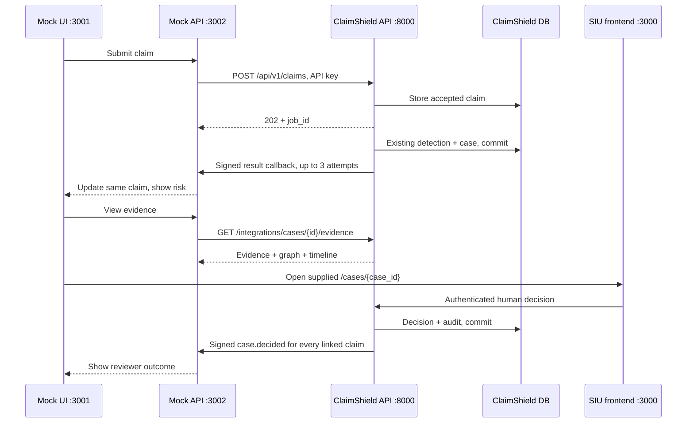

# Mock insurer ↔ ClaimShield integration

Mock system. Synthetic data only.

## Scope

This workspace supplies the ClaimShield dispatcher, webhook registry, opt-in machine reads,
demo tenant seed and API contract. The mock insurer is in a separate workspace; its pages,
database, receiver and live updates were not modified or verified here.

Share [claimshield-api-contract.md](claimshield-api-contract.md) with the mock team.



## ClaimShield environment

Merge [backend/.env.integration.example](../backend/.env.integration.example) into backend/.env
without overwriting existing settings:

```dotenv
MODEL_SERVER_URL=
FRONTEND_URL=http://localhost:3000
DEMO_API_KEY=demo_api_key_12345
DEMO_WEBHOOK_URL=http://localhost:3002/api/webhooks/claimshield
DEMO_WEBHOOK_SECRET=demo_webhook_secret
```

MODEL_SERVER_URL aliases existing ML_SERVER_URL; ML_SERVER_URL takes precedence if both
are set, even when blank. Leave unset/blank to retain local model artifacts. It points to
the optional model server, not the ClaimShield API. FRONTEND_URL controls case links.

DEMO_* variables configure the seed script. Changing them does not automatically change
stored registrations: rerun the seed or use admin webhook registration. Registry entries
are per-tenant in the existing config JSON under outbound_webhook_secrets. No table/column
was added. Existing config reads omit that key. The API key is stored only as a hash;
outbound signing secrets must be protected in database storage and backups.

No new dependencies: httpx, SQLAlchemy, Pydantic and pytest already exist; hmac is standard
library. No detection code, existing endpoint handler or SIU screen was changed.

## Seed the integration tenant

From the project root:

```powershell
.\backend\.venv\Scripts\python.exe backend/scripts/seed_demo_tenant.py
```

Or from backend/:

```powershell
.\.venv\Scripts\python.exe -m scripts.seed_demo_tenant
```

The script creates/reuses demo_tenant and its demo users, sets routing=0.70, enables tier 2
at 0.90 and registers all five callback events. It enables integration_read_access only
for this tenant. Requested case_opening.tier1_composite_threshold is retained as metadata;
the existing engine reads thresholds.routing, which is also set to 0.70.

It does not seed claims, retrain models, delete data or replace other tenants. Re-running
resets this demo tenant's integration credentials to the configured DEMO_* values.
Production and an existing non-demo tenant of the same slug are refused. It supports the
underscore slug directly without changing the existing tenant creation API/schema;
the database primary key remains a UUID.

## Start ClaimShield

Restart the existing backend after adding this code (Ctrl+C, then run):

```powershell
cd C:\Users\vigne\Desktop\acentra\Nexus-frontend\backend
.\.venv\Scripts\python.exe -m uvicorn app.main:app --host 127.0.0.1 --port 8000
```

Start the existing frontend in a second terminal:

```powershell
cd C:\Users\vigne\Desktop\acentra\Nexus-frontend
npm run dev
```

Frontend .env.local: NEXT_PUBLIC_API_URL=http://localhost:8000 and NEXT_PUBLIC_USE_MOCK=false.
Keep Clerk configuration as appropriate. Never put integration secrets in NEXT_PUBLIC variables.
Check /health and /docs; webhook registry and integration evidence routes should appear.
A process started before these edits needs a restart unless auto-reload is enabled.

## Mock team configuration

Configure in its separate backend workspace:

```dotenv
CLAIMSHIELD_API_URL=http://localhost:8000
CLAIMSHIELD_API_KEY=demo_api_key_12345
CLAIMSHIELD_TENANT_ID=demo_tenant
CLAIMSHIELD_WEBHOOK_SECRET=demo_webhook_secret
MOCK_BACKEND_PORT=3002
MOCK_FRONTEND_PORT=3001
```

Use that project's existing start commands for ports 3002 and 3001. Receiver responsibilities:
verify raw-body HMAC, deduplicate event IDs, update the same claim, handle all five events,
and broadcast live updates. Evidence proxy must use the added /integrations/cases/{id}/evidence
route. Use claimshield_status and decision_final, not fraud_flagged alone. Coverage review
and nullable scores are described in the API contract. Retain the synthetic-data disclaimer
on all mock screens. Use polling/result reconciliation if callbacks are missed.

## Tests

From backend/:

```powershell
.\.venv\Scripts\python.exe -m pytest -q
```

[Webhook tests](../backend/tests/integration/test_outbound_webhooks.py) use an isolated
synthetic SQLite database and an httpx receiver. They exercise real ingestion/detection,
case creation/update, human decisions and audit; verify signatures, raw bytes, post-commit
visibility, retries, rollback suppression, receiver failure, coverage review, machine-read
tenant isolation and model-server environment aliases.

A four-process browser demonstration requires the external mock workspace. Passing backend
tests does not establish that its risk card or evidence modal works.

## Troubleshooting

| Symptom | Check |
| --- | --- |
| No Python at C:\Python312\python.exe | Recreate the moved .venv using installed Python |
| No module named uvicorn | Install requirements.txt with the .venv Python |
| Registry route returns 404 | Restart API and inspect /docs |
| Callback cannot connect | Mock API must listen on 3002; check stored registry URL |
| Callback returns 401 | HMAC raw bytes, configured secret, no sha256= prefix |
| Evidence proxy returns 403 | Integration route and integration_read_access opt-in |
| SIU case returns 404 | Login and select Mock Insurer Demo; IDs are tenant-scoped |
| Mock claim stuck processing | Handle claim.processed/claim.failed or poll integration result |
| Null risk | Could be coverage_review; do not show a clean FWA result |
| No callback after identical resubmission | Existing idempotency skips detection; reconcile result |
| Model version warnings | Retrain a new version in the active Python environment |
| Localhost between containers fails | Configure reachable service names for both API and callback |

Structured log events: webhook_delivered, webhook_delivery_failed, webhook_delivery_exhausted,
webhook_dispatch_error. Registration and integration reads also create tenant audit entries.
No new webhook-log table/endpoint was added; receiver logs belong to the mock workspace.

## Limitations and next steps

- No durable outbox or replay after a crash. Poll the result endpoint to reconcile. A
  production delivery queue needs a separately approved schema/design change.
- Three ten-second attempts plus 0.5s/1s backoff can add approximately 31.5 seconds per
  claim/destination. Data is already committed; callbacks are delivered sequentially.
- Concurrent workers can deliver out of order. Receivers should deduplicate event_id and
  avoid downgrading final outcomes with older callbacks.
- ORM commits through the existing session factory are observed. Raw SQL/bulk updates
  outside that path do not emit integration callbacks.
- Fixed credentials are synthetic local demo credentials; the seed refuses production.
  No automatic claim denial or fraud conclusion is introduced.
- Normal SIU login and correct tenant selection are still required. No auto-login,
  automatic tenant selection or new /siu route was added.
- Model quality and production throughput are not validated by integration tests.

Run the real receiver, submit a duplicate pair, view in-UI evidence and record a human
decision. Verify receiver receipts and ClaimShield's case.decision audit before declaring
the full browser integration complete.

## Verification recorded on 2026-10-08

- Full backend suite: **113 passed** (38.23 seconds), including ten new webhook integration tests.
- Live API /health: HTTP 200.
- Demo tenant seed ran successfully; demo API key authenticated against the live API.
- Tenant UUID: b74a9283-eca6-48bd-a0cf-729063c73a27; slug: demo_tenant.
- The existing process on port 8000 still serves pre-change code and requires a restart for the new routes.
- The actual mock receiver and its browser UI were unavailable in this workspace, so delivery to that receiver and the four-process browser flow were not tested.
